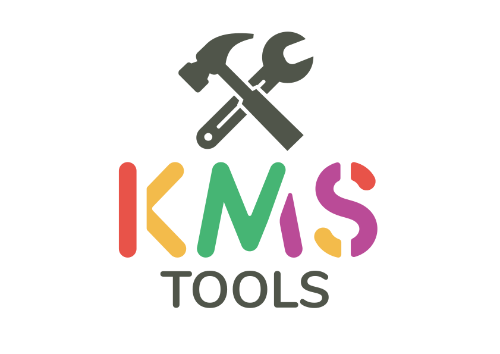
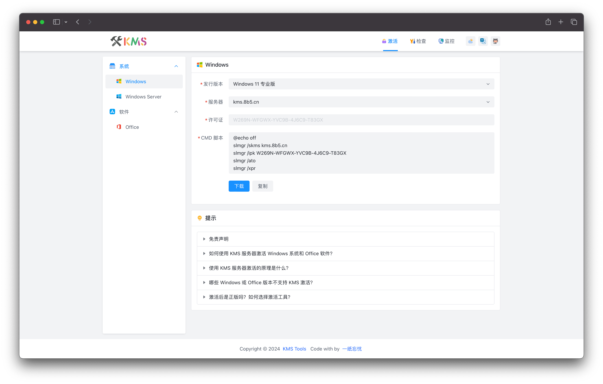
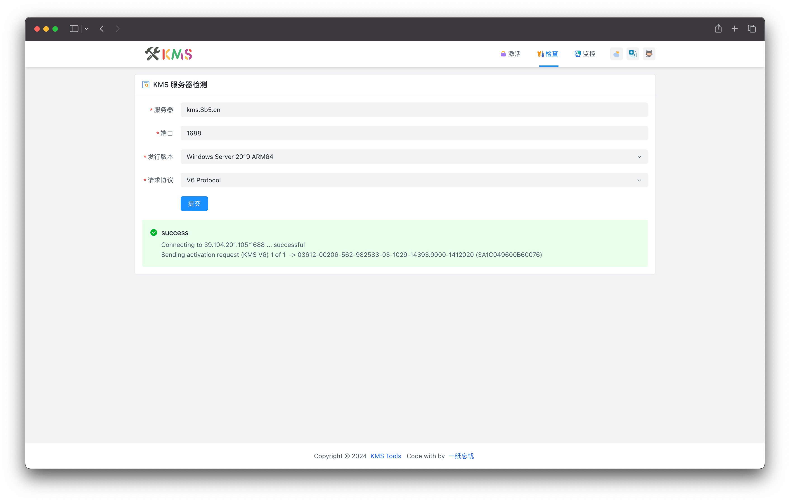
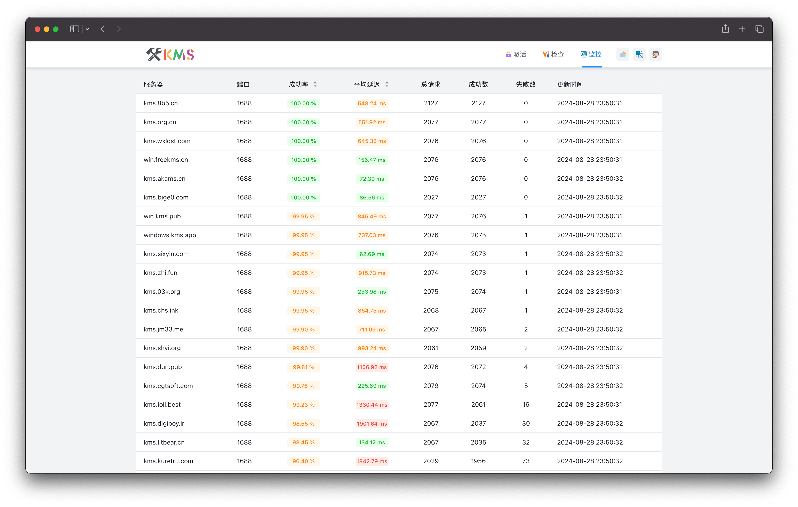

<p align="center">
  
</p>

<p align="center">
  <a href="https://github.com/ikxin/kms-tools/releases"></a>
  <a href="https://github.com/ikxin/kms-tools/actions/workflows/ci.yml"></a>
  <a href="https://github.com/ikxin/kms-tools/stargazers"></a>
  <a href="https://github.com/ikxin/kms-tools/network/members"></a>
  <a href="https://github.com/ikxin/kms-tools/blob/main/LICENSE"></a>
</p>

<p align="center">
  <a href="./README.md">简体中文</a> | <a href="./README.en.md">English</a>
</p>

## 📖 Introduction

KMS Tools is an all-in-one KMS toolbox built with the Nuxt 4 full-stack framework. It integrates KMS activation script generation, KMS server detection, and KMS server status monitoring.

> [!NOTE]
> The application runs on Cloudflare Workers and requires Cloudflare D1 to store monitored servers and check records. Local development uses a local D1 database provided by Wrangler.

## ✨ Features

- 🔑 **KMS Activation Script Generation** - One-click generation of KMS activation scripts for Windows / Windows Server / Office
- 🔍 **KMS Server Check** - Real-time detection of KMS server availability and response time
- 📊 **KMS Server Monitoring** - Continuous monitoring of multiple KMS servers with visual charts
- 🌍 **Internationalization** - Support for Simplified Chinese and English
- 🌗 **Dark Mode** - Light / Dark / System theme modes
- ☁️ **Cloudflare Workers Deployment** - Persist monitoring data in D1 and schedule checks with Cron Triggers

## 🌈 Preview

| KMS Activation Script                 | KMS Server Check                   | KMS Server Monitoring                |
| ------------------------------------- | ---------------------------------- | ------------------------------------ |
|  |  |  |

## 📦 Demo

https://kms.ikxin.com

## 🛠️ Tech Stack

| Technology                                                        | Description                                            |
| ----------------------------------------------------------------- | ------------------------------------------------------ |
| [Nuxt](https://github.com/nuxt/nuxt)                              | Full-stack web application framework based on Vue.js   |
| [Vue.js](https://github.com/vuejs/core)                           | Progressive JavaScript framework                       |
| [Nitro](https://github.com/nitrojs/nitro)                         | High-performance web server framework based on unjs/h3 |
| [Vite](https://github.com/vitejs/vite)                            | Fast dev server and modern build tool                  |
| [TypeScript](https://github.com/microsoft/TypeScript)             | JavaScript superset with type system                   |
| [Tailwind CSS](https://github.com/tailwindlabs/tailwindcss)       | Utility-first CSS framework                            |
| [Arco Design Vue](https://github.com/arco-design/arco-design-vue) | Enterprise-level design system by ByteDance            |
| [ECharts](https://github.com/apache/echarts)                      | Feature-rich interactive charting library              |
| [Cloudflare Workers](https://developers.cloudflare.com/workers/)  | Application runtime and scheduled tasks                |
| [Drizzle ORM](https://github.com/drizzle-team/drizzle-orm)        | Type-safe database access and migrations               |
| [Cloudflare D1](https://developers.cloudflare.com/d1/)            | Cloudflare SQLite database                             |
| [Nuxt I18n](https://github.com/nuxt-modules/i18n)                 | Internationalization plugin for Nuxt                   |

## 📦 Deployment

The application runs on Cloudflare Workers and requires a Cloudflare D1 database bound as `DB`. Worker, D1, Cron Trigger, and logging settings are maintained in `wrangler.jsonc`.

The base URL for the site and localized links is fixed to `https://kms.ikxin.com`. Frontend API requests use same-origin relative paths, so no URL environment variables are required. Bind this domain to the Worker after deployment.

### Create and bind a D1 database

After installing dependencies, log in to Cloudflare and create the database:

```bash
pnpm exec wrangler login
pnpm exec wrangler d1 create kms-tools
```

Add the returned `database_id` to the `d1_databases` entry in `wrangler.jsonc`, keeping the binding name `DB`. If a database already exists, use its ID. Local development does not require a remote database ID.

### Initialize the database and deploy

```bash
# Apply remote database migrations
pnpm run db:migrate:remote

# Build and deploy the Worker
pnpm run build
pnpm run deploy
```

Nitro merges `wrangler.jsonc` into the generated Worker deployment configuration during the build. `pnpm run deploy` uses that configuration to publish the application. Apply any new remote migrations before subsequent deployments as well.

### Configure monitored servers

Migrations create empty `servers` and `monitor_records` tables. Manage monitored servers through the `host`, `port`, and `enabled` fields in `servers`, for example:

```bash
pnpm exec wrangler d1 execute DB --remote --config wrangler.jsonc --command "INSERT OR IGNORE INTO servers (host, port) VALUES ('kms.org.cn', 1688)"
```

Monitoring runs every 10 minutes by default. To change the schedule, update both `triggers.crons` in `wrangler.jsonc` and `nitro.scheduledTasks` in `nuxt.config.ts`.

## 🔧 Local Development

```bash
# Clone the repository and install dependencies
git clone https://github.com/ikxin/kms-tools.git
cd kms-tools
pnpm install

# Apply local D1 migrations and start the development server
pnpm run dev
```

The development server accesses local D1 through Wrangler's bindings proxy. Data persists in `.wrangler/state/v3` without requiring a Cloudflare login. Local API requests use the development server, and local data is separate from remote D1.

Add a local monitored server:

```bash
pnpm exec wrangler d1 execute DB --local --config wrangler.jsonc --command "INSERT OR IGNORE INTO servers (host, port) VALUES ('kms.org.cn', 1688)"
```

After changing `server/database/schema.ts`, generate and apply migrations:

```bash
pnpm run db:generate
pnpm run db:migrate:local
```

## 🤝 Contributing

Contributions of all kinds are welcome! Please read the [Contributing Guide](./CONTRIBUTING.md) first.

1. Fork this repository
2. Create your feature branch (`git checkout -b feature/amazing-feature`)
3. Commit your changes (`git commit -m 'feat: add amazing feature'`)
4. Push to the branch (`git push origin feature/amazing-feature`)
5. Open a Pull Request

## ⭐ Star History


## 💖 Sponsors

CDN acceleration and security protection for this project are sponsored by Tencent EdgeOne.

[](https://edgeone.ai?from=github)

## 📄 License

This project is licensed under the [MIT License](./LICENSE).

## 🧑‍💻 Author

Code with ❤️ by [一纸忘忧](https://blog.ikxin.com '一纸忘忧')
