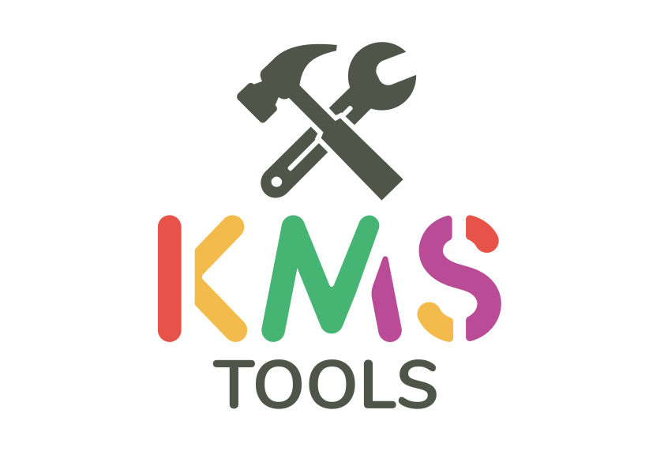
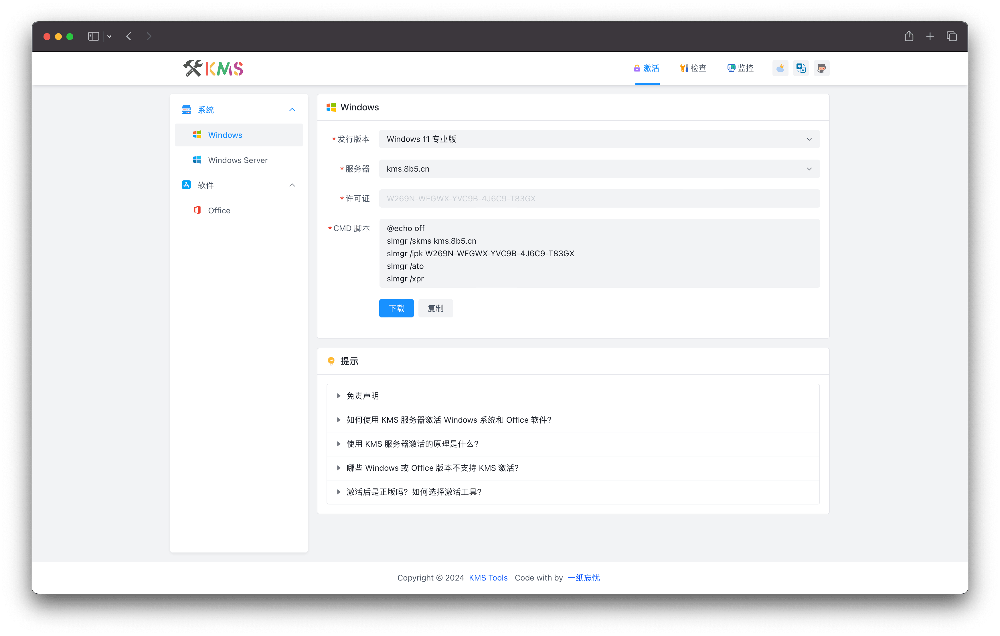
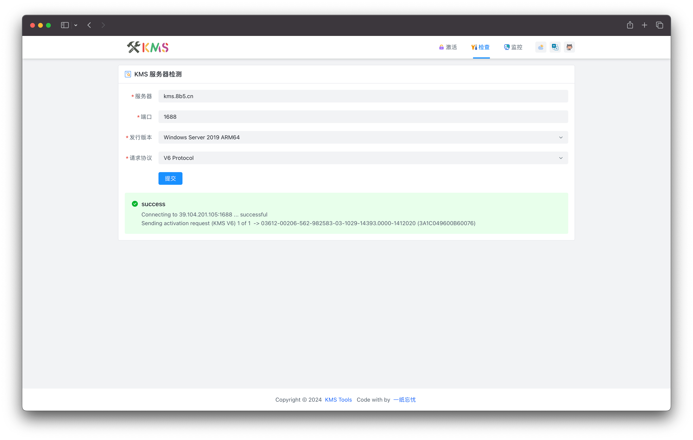
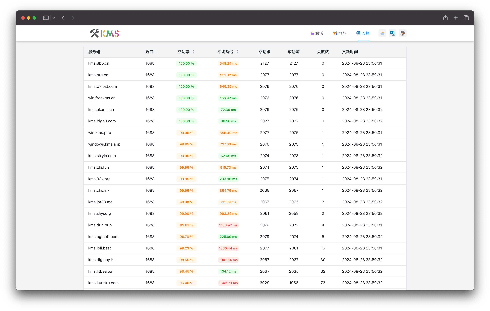

<p align="center">
  
</p>

<p align="center">
  <a href="https://github.com/ikxin/kms-tools/releases"></a>
  <a href="https://github.com/ikxin/kms-tools/actions/workflows/ci.yml"></a>
  <a href="https://github.com/ikxin/kms-tools/stargazers"></a>
  <a href="https://github.com/ikxin/kms-tools/network/members"></a>
  <a href="https://github.com/ikxin/kms-tools/blob/main/LICENSE"></a>
</p>

<p align="center">
  <a href="./README.md">简体中文</a> | <a href="./README.en.md">English</a>
</p>

## 📖 介绍

KMS Tools 是一个一站式 KMS 工具箱，基于 Nuxt 4 全栈框架构建，集成了 KMS 激活脚本生成、KMS 服务器检测、KMS 服务器状态监控等功能。

> [!NOTE]
> 项目统一部署到 Cloudflare Workers，使用 Cloudflare D1 保存监控服务器配置和检测记录。本地开发通过 Wrangler 运行本地 D1。

## ✨ 功能特性

- 🔑 **KMS 激活脚本生成** - 一键生成 Windows / Windows Server / Office 的 KMS 激活脚本
- 🔍 **KMS 服务器检测** - 实时检测 KMS 服务器的可用性和响应时间
- 📊 **KMS 服务器监控** - 持续监控多个 KMS 服务器的运行状态，提供可视化图表
- 🌍 **国际化支持** - 支持简体中文和英文界面切换
- 🌗 **暗色模式** - 支持亮色 / 暗色 / 跟随系统三种主题模式
- ☁️ **Cloudflare Workers 部署** - 使用 D1 持久化监控数据，通过 Cron Triggers 定时检测

## 🌈 界面预览

| KMS 激活脚本生成                      | KMS 服务器检测                     | KMS 服务器状态监控                   |
| ------------------------------------- | ---------------------------------- | ------------------------------------ |
|  |  |  |

## 📦 演示

https://kms.ikxin.com

## 🛠️ 技术栈

| 技术                                                              | 说明                                 |
| ----------------------------------------------------------------- | ------------------------------------ |
| [Nuxt](https://github.com/nuxt/nuxt)                              | 基于 Vue.js 的全栈 Web 应用框架      |
| [Vue.js](https://github.com/vuejs/core)                           | 渐进式 JavaScript 框架               |
| [Nitro](https://github.com/nitrojs/nitro)                         | 基于 unjs/h3 的高性能 Web 服务端框架 |
| [Vite](https://github.com/vitejs/vite)                            | 极速开发服务器和现代构建工具         |
| [TypeScript](https://github.com/microsoft/TypeScript)             | 带类型系统的 JavaScript 超集         |
| [Tailwind CSS](https://github.com/tailwindlabs/tailwindcss)       | 实用性优先的 CSS 框架                |
| [Arco Design Vue](https://github.com/arco-design/arco-design-vue) | 字节跳动开发的企业级产品设计系统     |
| [ECharts](https://github.com/apache/echarts)                      | 功能丰富的交互式图表库               |
| [Drizzle ORM](https://github.com/drizzle-team/drizzle-orm)        | 类型安全的数据库访问与迁移工具       |
| [Cloudflare D1](https://developers.cloudflare.com/d1/)            | Cloudflare 原生 SQLite 数据库        |
| [Cloudflare Workers](https://developers.cloudflare.com/workers/)  | 应用运行与定时任务                   |
| [Nuxt I18n](https://github.com/nuxt-modules/i18n)                 | 适用于 Nuxt 的国际化支持插件         |

## 📦 部署

项目使用 Cloudflare Workers 运行应用，并且必须绑定名为 `DB` 的 Cloudflare D1 数据库。Workers、D1、Cron Triggers 和日志配置统一维护在 `wrangler.jsonc` 中。

站点和多语言链接基础地址固定为 `https://kms.ikxin.com`，前端 API 请求使用同源相对路径，无需配置地址相关环境变量。部署后需要将该域名绑定到 Worker。

### 创建并绑定 D1 数据库

安装依赖后，登录 Cloudflare 并创建数据库：

```bash
pnpm exec wrangler login
pnpm exec wrangler d1 create kms-tools
```

将命令返回的 `database_id` 添加到 `wrangler.jsonc` 的 `d1_databases` 配置中，保留绑定名称 `DB`。如果已有数据库，填入现有数据库的 ID 即可。本地开发不需要远程数据库 ID。

### 初始化数据库并部署

```bash
# 应用远程数据库迁移
pnpm run db:migrate:remote

# 构建 Workers 应用并部署
pnpm run build
pnpm run deploy
```

构建时 Nitro 会合并 `wrangler.jsonc` 并生成 Workers 部署配置，`pnpm run deploy` 使用该配置发布应用。后续部署前，也需要先应用新增的远程数据库迁移。

### 配置监控服务器

迁移会创建 `servers` 和 `monitor_records` 两张空表。监控列表通过 `servers` 表中的 `host`、`port` 和 `enabled` 字段管理，例如：

```bash
pnpm exec wrangler d1 execute DB --remote --config wrangler.jsonc --command "INSERT OR IGNORE INTO servers (host, port) VALUES ('kms.org.cn', 1688)"
```

监控任务默认每 10 分钟执行一次。修改频率时，请同时更新 `wrangler.jsonc` 的 `triggers.crons` 和 `nuxt.config.ts` 的 `nitro.scheduledTasks`。

## 🔧 本地开发

```bash
# 克隆项目并安装依赖
git clone https://github.com/ikxin/kms-tools.git
cd kms-tools
pnpm install

# 自动应用本地 D1 迁移并启动开发服务器
pnpm run dev
```

开发服务器通过 Wrangler 提供的绑定代理访问本地 D1，数据库持久化在 `.wrangler/state/v3`，无需登录 Cloudflare。本地 API 请求使用当前开发服务器，数据与远程 D1 相互独立。

添加本地监控服务器：

```bash
pnpm exec wrangler d1 execute DB --local --config wrangler.jsonc --command "INSERT OR IGNORE INTO servers (host, port) VALUES ('kms.org.cn', 1688)"
```

修改 `server/database/schema.ts` 后，生成并应用迁移：

```bash
pnpm run db:generate
pnpm run db:migrate:local
```

## 🤝 参与贡献

欢迎各种形式的贡献！请先阅读 [贡献指南](./CONTRIBUTING.md)。

1. Fork 本仓库
2. 创建你的功能分支 (`git checkout -b feature/amazing-feature`)
3. 提交你的更改 (`git commit -m 'feat: add amazing feature'`)
4. 推送到分支 (`git push origin feature/amazing-feature`)
5. 提交 Pull Request

## ⭐ Star 历史


## 💖 赞助商

本项目 CDN 加速及安全防护由 Tencent EdgeOne 赞助。

[](https://edgeone.ai/zh?from=github)

## 📄 开源协议

本项目基于 [MIT License](./LICENSE) 开源。

## 🧑‍💻 作者

Code with ❤️ by [一纸忘忧](https://blog.ikxin.com '一纸忘忧')

## 📜 开源协议

[MIT License](./LICENSE 'MIT License') Copyright (c) 2022 ~ Present
